# dolores_rally

A new Flutter project.

## Getting Started

This project is a starting point for a Flutter application.

A few resources to get you started if this is your first Flutter project:

- [Learn Flutter](https://docs.flutter.dev/get-started/learn-flutter)
- [Write your first Flutter app](https://docs.flutter.dev/get-started/codelab)
- [Flutter learning resources](https://docs.flutter.dev/reference/learning-resources)

For help getting started with Flutter development, view the
[online documentation](https://docs.flutter.dev/), which offers tutorials,
samples, guidance on mobile development, and a full API reference.

## Ronda 1 · Diseña el juego antes de programarlo
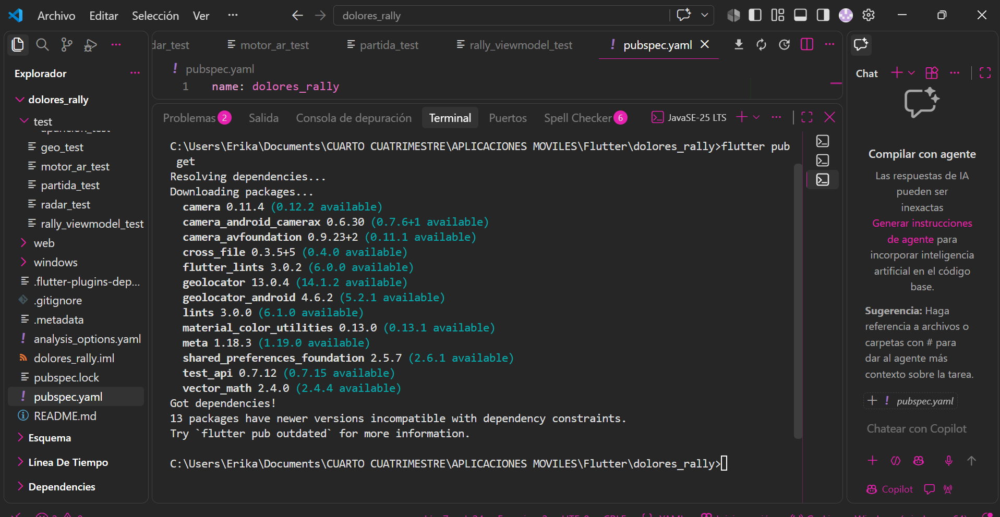

## Ronda 2 · Geometría de la Tierra (con una función nueva)
### ROJO
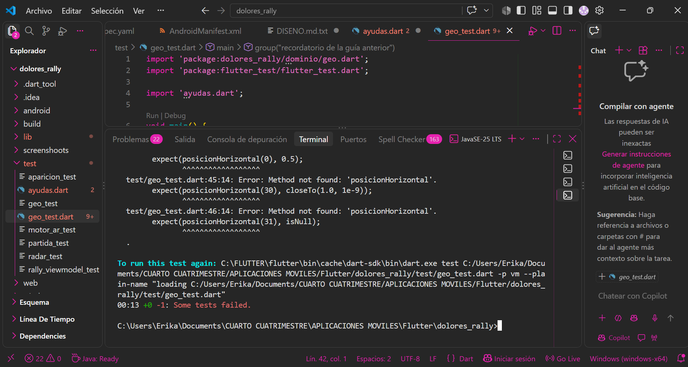

### VERDE
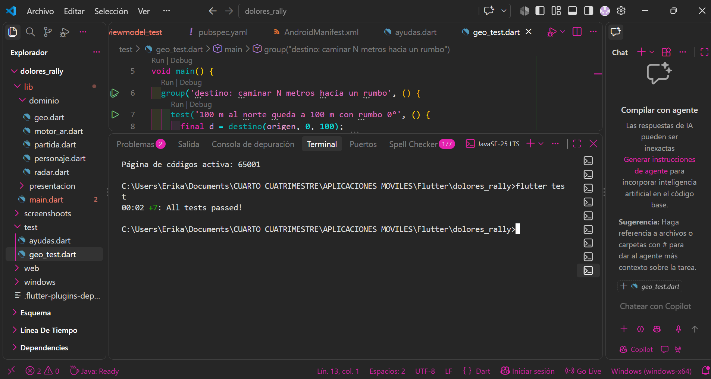

## Ronda 3 · Los personajes y sus preguntas
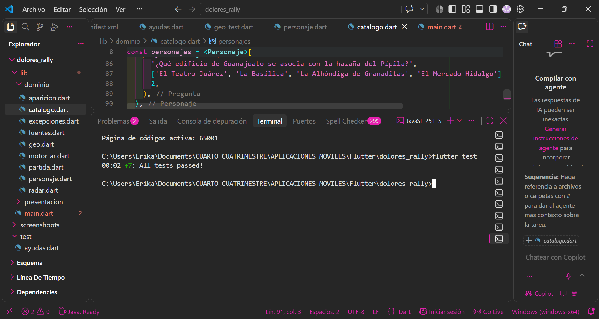

## Ronda 4 · Esconder personajes: azar que se puede probar
### ROJO
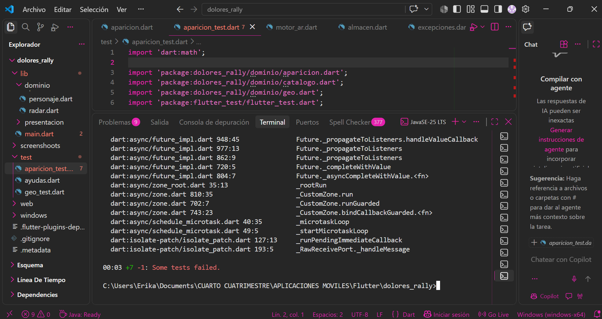

### VERDE

## Ronda 5 · Radar y "frío o caliente"
### ROJO
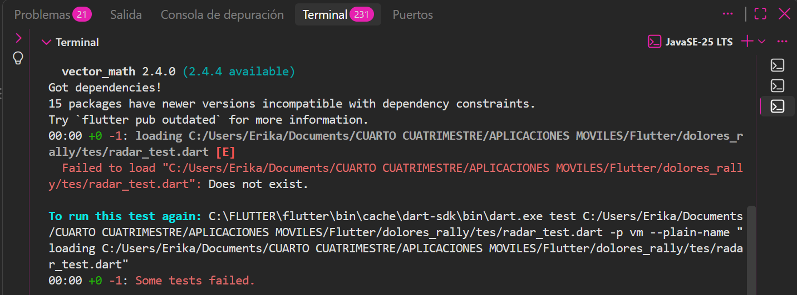

### VERDE
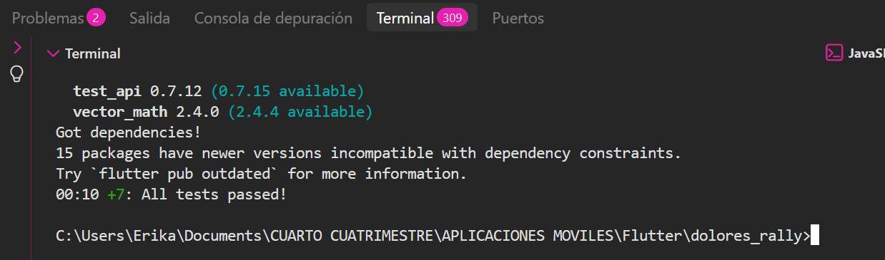

## Ronda 6 · El motor de realidad aumentada
### ROJO
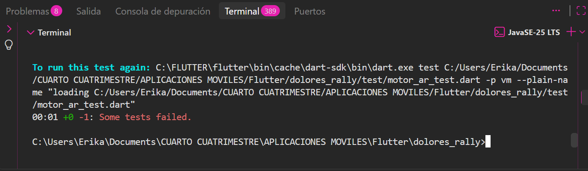

### VERDE
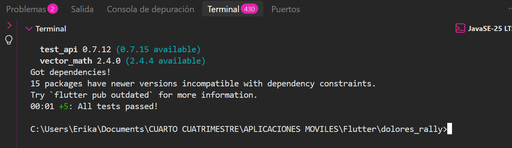

## Ronda 7 · Las reglas del juego (la clase Partida)
### ROJO
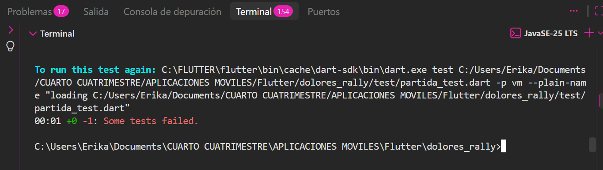

### VERDE
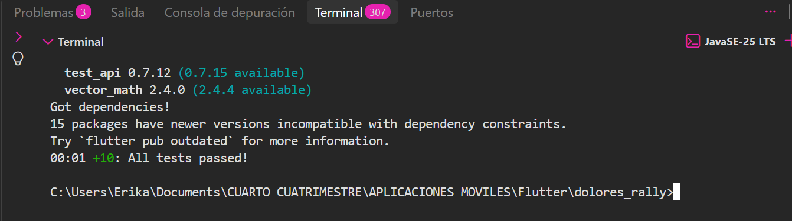

## Ronda 8 · Guardar el progreso (álbum)
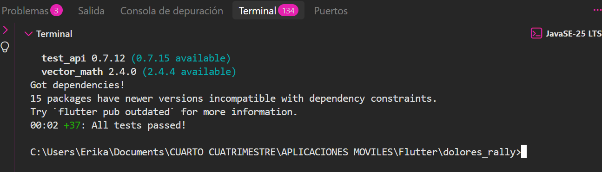

## Ronda 9 · Fuentes de posición y brújula (reales y simuladas)
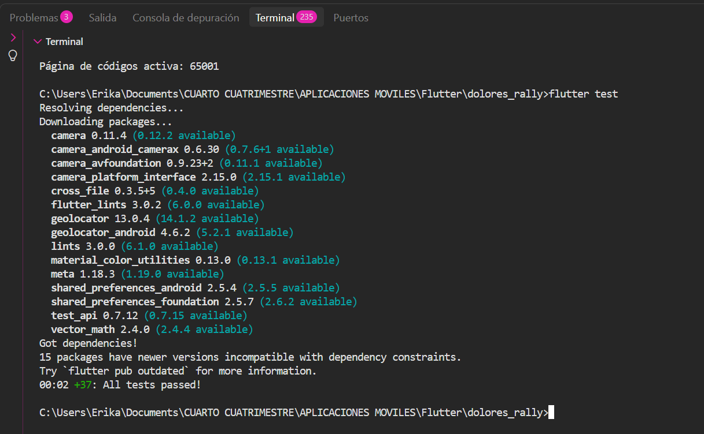

## Ronda 10 · El ViewModel del juego
### ROJO
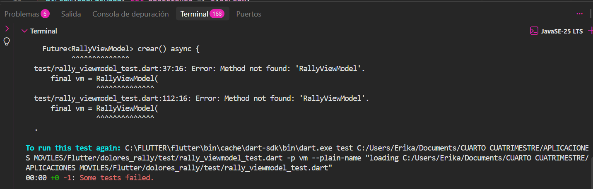

### VERDE
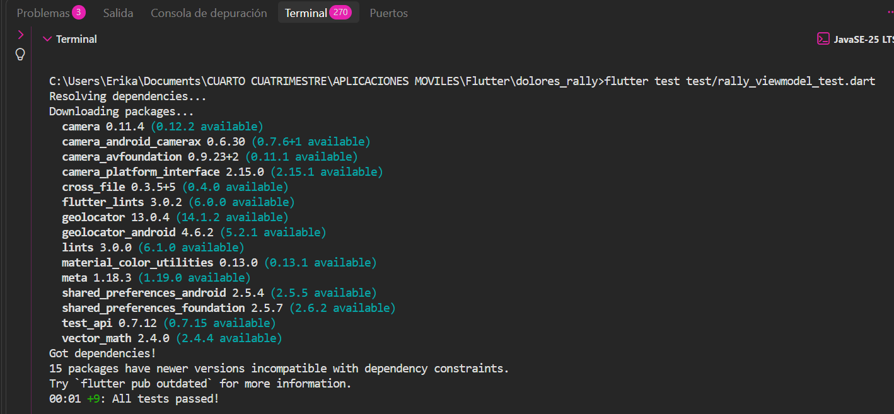

## Ronda 11 · Las pantallas
### Paso 11.1 · El fondo de cámara
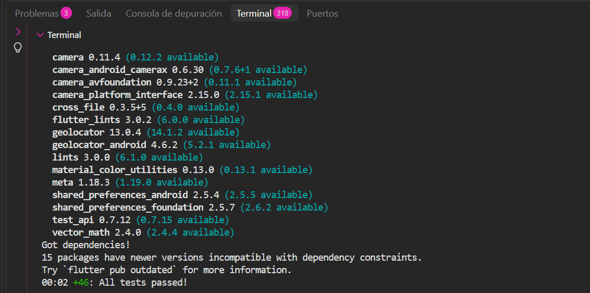

### Paso 11.2 · El radar con CustomPainter
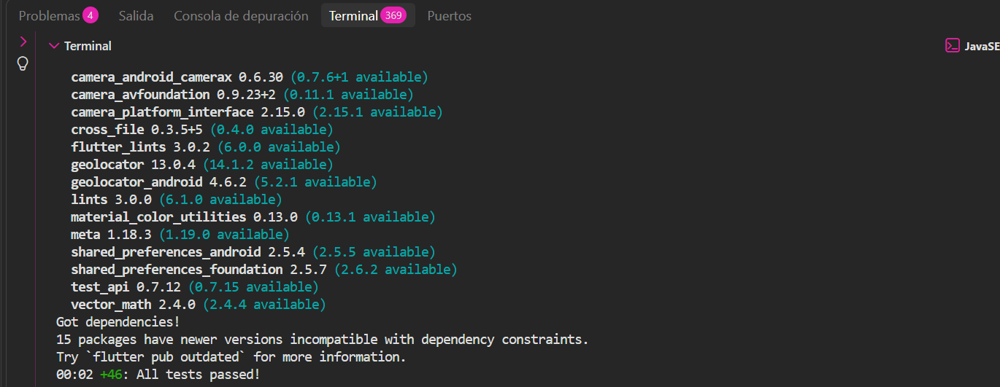

### Paso 11.3 · La pantalla del juego
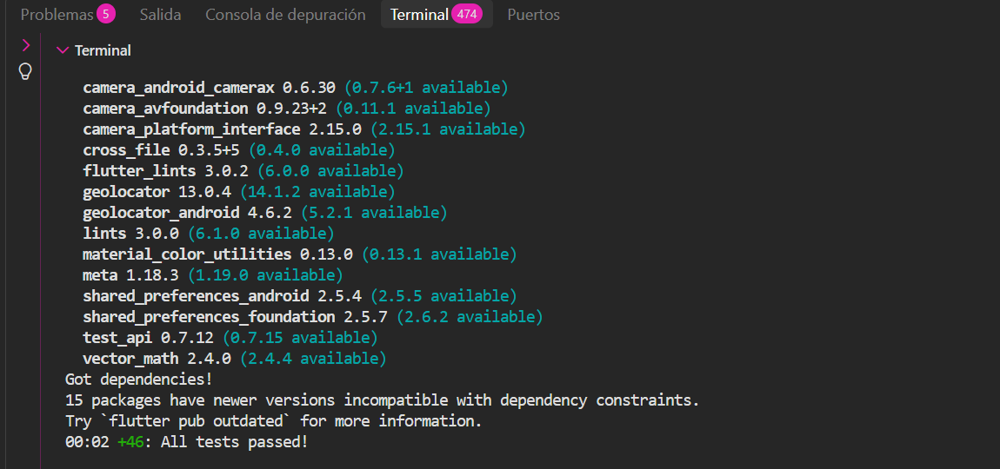

### Paso 11.4 · Álbum, inicio y main
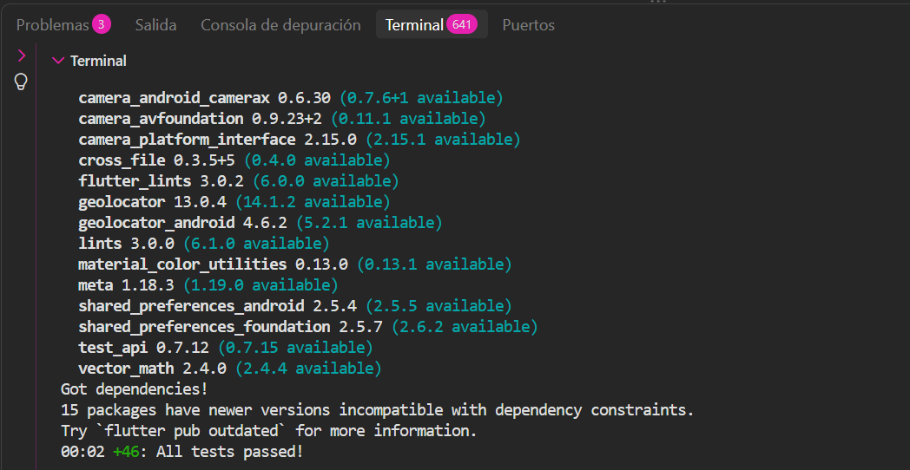

## Paso 11.5 · Primera partida en modo demo
|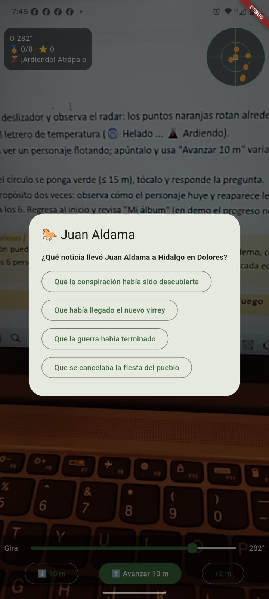|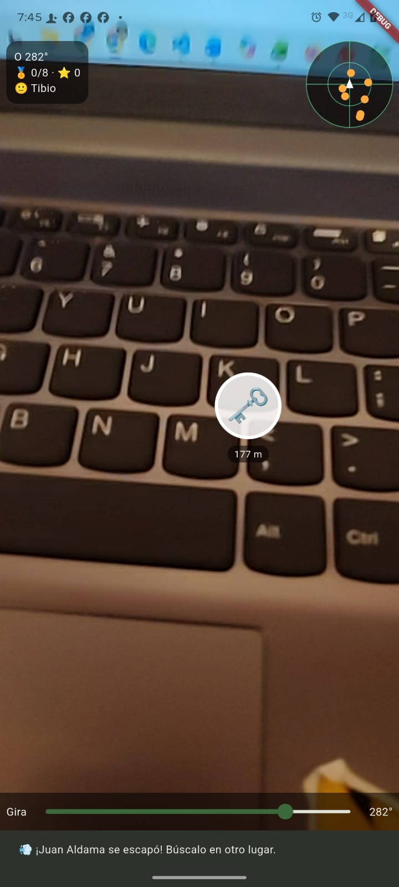|
|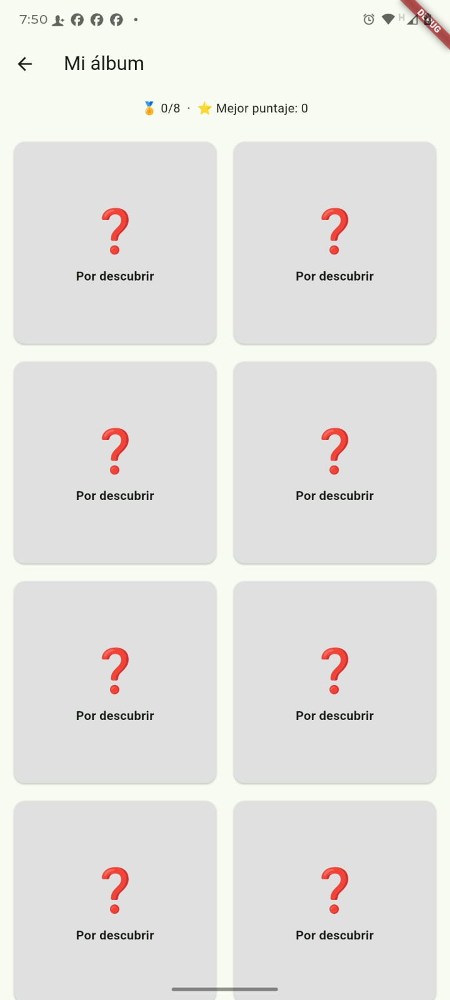|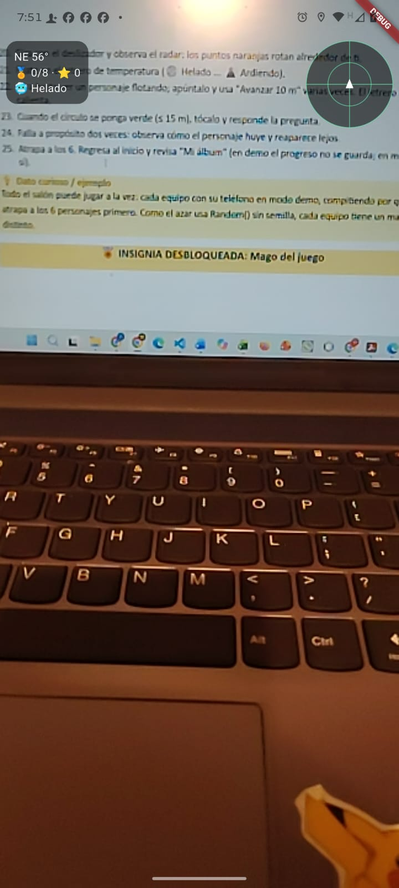|

